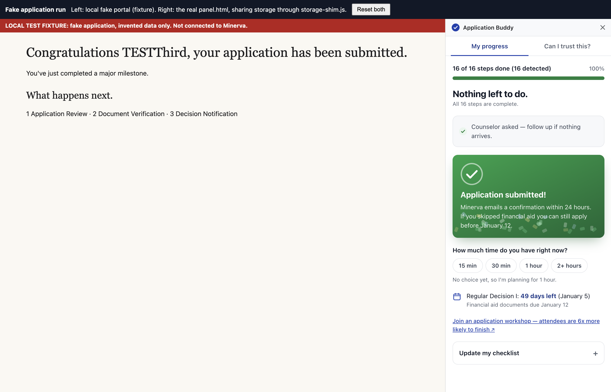

# Application Buddy: real-flow mapping, test runs and auto-detection

Prepared Nov 17, 2026 for Aibiike (follow-up from the meeting with Ben). The code is on branch `buddy-real-flow-autodetect`. Nothing was pushed to `main`.

## Summary

**Done**

- **Screen map.** I mapped all 196 screenshots in Ben's folder into 25 ordered screens and listed 11 gaps. See [SCREEN-MAP.md](SCREEN-MAP.md).
- **Extension fixed to match the real Admission Center.**
  - The old 9 steps are now 16 required steps plus 1 optional step (financial aid).
  - The steps use the real names and order.
  - Lock rules now follow the real hub: everything opens after Part 1, Expression needs Verify ID, and Submit needs every part closed.
- **Auto-detection prototype.** It covers the steps rated Easy (`detector.js` and `content.js`), and all 11 detector test cases pass.
  - It reads status labels only. It stores only step ids, a timestamp and a signal name, locally.
  - It runs only on localhost test pages, not on minerva.edu.
- **Fake application runs.** I ran three start-to-submit runs against a **local fake portal** that copies the real screens. They exposed one tracking gap (described below), which I fixed. After the fix, the extension reached 16/16 on its own, with no manual ticks.
- **Notes on the progress/achievements feature.** See [Achievements notes](#5-the-applications-own-progress--achievements-feature) below. No integration was built.

**Blocked**

- **No fake application on Minerva's real system.**
  - The brief's test identity was still the placeholder `[TEST EMAIL / ACCOUNT I CONTROL]`.
  - I did not make up an email address. Part 1 creates an account and requires email verification, so an invented address would belong to a stranger or bounce.
  - I did not use your own logged-in Minerva account either.
  - Real submissions: **0 of 3 used**.
- **A full real submit would hit a stop point anyway.** Verify ID needs a live face photo and a government photo ID. The graded Expression challenge refuses to start without it, and Submit needs Expression. Under the rules I would have had to stop at Verify ID. Ben's own capture got past this on **staging** by using a fake webcam feed, which is his team's call, not ours.
- **The meeting recording is not in the folder.** The folder has only the 30 screenshot sub-folders plus README.md and MANIFEST.md, with no video or audio. A Drive-wide search for videos turned up nothing that looks like this meeting. One candidate exists: "tl;dv - app 2026-10-20 14_15.mp4". I did **not** open it because it is outside the folder and predates the extension (Nov 11). Nothing from the recording is in this report.

**Decide next**

1. **Real test identity and environment.**
   - Give me a test identity, or ask Ben for a staging login like the "test test" / "LukasTest" accounts in his set.
   - Staging is the right place for fake runs. Production would create real applicant records and send real emails.
2. **Pilot on staging?** Should auto-detection run on Ben's staging origin? That is a one-line change in `manifest.json` (`content_scripts.matches`), but per Ben's point 3 it should follow a privacy review, so I left it off.
3. **Old web demo.** `application-buddy.html`, the root web demo, still shows the old 9 steps. Should it be updated to match, or retired?
4. **Questions for Ben.**
   - Can his team fill the gaps in the screen map? In particular: the hub after each "Close" button, a saved Academic Performance row, a saved Disciplinary row, and the incomplete Parent/Guardian row.
   - Can they give us the URL patterns?
   - Do they know where the meeting recording is?

---

## 1. Screen map

See [SCREEN-MAP.md](SCREEN-MAP.md) for the full ordered table: name, URL pattern, required fields, completion criteria, progress indicators, detection text, and gaps.

## 2. Extension vs the real flow

| Old extension step (v0.1) | Real application | Problem | Fix in v0.2 |
|---|---|---|---|
| 1 "Part 1: Bio & academic info" | **Part 1: Basic Information** (creates the account) | Wrong name. It also locked only the timed steps, while the real hub locks everything behind Part 1. | Renamed, and every step is now locked until Part 1 is done. |
| 2 "Math challenge" (8–20 min) | **Math**, 8 min, 3rd challenge on the hub | Out of order; wrong time | Moved; 8 min |
| 3 "Logical Reasoning challenge" | **Reasoning**, 21 min | Wrong name and time | Renamed; 21 min |
| 4 "Reading Comprehension challenge" | **Understanding**, 7 min, 1st challenge | Wrong name, order and time | Renamed, moved first; 7 min |
| 5 "Divergent Thinking challenge" | **Creativity**, 8 min, no practice ("Divergent Thinking" is the graders' category, not what applicants see) | Wrong name | Renamed; 8 min |
| 6 "Written communication task" | **Writing** challenge, 20 min, no practice | Wrong name | Renamed |
| 7 "Verbal communication task" | **Expression** challenge, 5 recorded videos, ~15–25 min, **needs Verify ID first** | Wrong name; dependency missing | Renamed; locked until Verify ID |
| 8 "Accomplishments" | **Part 3**: at least 3 needed to submit, 6 recommended | Minimum and target missing | "Accomplishments (3 minimum, 6 recommended)" |
| 9 "Academic background" | **Academic Performance** row in *Official Documents & Information* (self-reported school details; school contacts send the records) | Wrong name and section | Renamed and regrouped; counselor reminder kept |
| — | **Close Part 2**, **Close Part 3**, **Close This Section** | Missing (real required clicks that gate Submit) | Added |
| — | **Verify your ID** (webcam face + government ID) | Missing | Added |
| — | **Parent/Guardian contact information** | Missing | Added |
| — | **Disciplinary Record** | Missing | Added |
| — | **Financial aid: apply or "Skip for now"** (optional, never in "Missing steps") | Missing | Added as **optional**, not counted in progress |
| — | **Submit → "Mark as Complete"** | Missing ("submit" was implied when all 9 were done) | Added as the final step |
| — | Email verification after Part 1 | Not on the hub | **Not added** (account-level; see gaps) |

Other changes:

- The checklist is grouped by hub section (Part 1, Part 2, Part 3, Official Documents & Information, Submit).
- Locked rows explain what they are waiting for.
- The "Next step" hint for challenges now says a laptop or desktop with webcam and microphone is needed and that the graded challenge can be taken only once.
- After submission the panel says "Application submitted!" instead of "submit before…".
- The storage key moved to `minervaBuddy.v2`, so old v0.1 progress is not carried over.

## 3. Test report: fake application runs

### Submission log

| # | When (PT, Nov 17 2026) | Where | Test identity (all invented) | What was submitted |
|---|---|---|---|---|
| — | — | **Minerva (real system)** | — | **None.** Blocked: no test identity was provided, and there are ID-check stop points. 0 of 3 allowed used. |
| F1 | Part 1 at 14:32:19, submitted at 14:33:15 | Local fake portal (`test/fake-portal.html`, never touches Minerva) | TESTFirst TESTLast, testfirst.testlast@example.com | Part 1 (name, email, two agreements). 6 simulated challenges (no answers). 3 accomplishment titles ("TEST project: …"). School "TEST Fixture High School". Financial aid: **Skip for now**. Simulated ID check (no camera, no images). Parent "TESTParent TESTGuardian, testparent@example.com". Disciplinary "No". Closed all sections. FA-decline confirmation, then Mark as Complete. |
| F2 | 14:34:13 → 14:34:33 | Local fake portal | TESTSecond TESTApplicant, testsecond.testapplicant@example.com | Same as F1, but financial aid left **undecided** (the plain Mark as Complete path). School "TEST Fixture Academy". |
| F3 | 15:03:39 → 15:03:53 | Local fake portal (re-run on a new port to take the screenshots) | TESTThird TESTApplicant, testthird.testapplicant@example.com | Same as F1 (aid skipped). |

The fake portal accepts only names containing "TEST" and reserved test email domains (`example.com` and `*.test`). Its Verify ID and Financial Aid Center screens are stand-ins that say they are stop points on the real site.

### Where the extension kept up and where it fell behind

Run F1 used the first detector version. The panel was read about 1 second after each action.

| Moment in the run | Panel showed | Verdict |
|---|---|---|
| Part 1 submitted, hub opens | 1/16, Part 1 ✓ (detected) | **Tracks** |
| A challenge finished, on the "Well done. You have completed your challenge." page | No change | **Lags.** That page never names the challenge. |
| Back on the hub or lobby after each challenge | +1 each, from 2/16 to 6/16 | **Tracks** (once the applicant returns to the hub) |
| "Verification Complete!" page | Verify ID ✓ immediately | **Tracks** |
| Expression done, then Close Part 2 | 8/16, then 9/16 | **Tracks** |
| 3 accomplishments saved | No change | **Falls behind.** There is no reliable per-row signal yet. |
| Close Part 3 | Close Part 3 ✓, **but Accomplishments was still open and "Next: Accomplishments"** | **Bug:** the panel contradicted the page |
| School saved / Disciplinary saved | No change | **Falls behind** (rated Possible, not prototyped) |
| Financial aid "Skip for now" | Optional row ✓ | **Tracks** |
| Parent/Guardian saved | ✓ | **Tracks** |
| Close This Section | 12/16 | **Tracks** the close itself, but Academic and Disciplinary were still open |
| "Mark Your Application as Complete" modal open | No change (correct, not yet submitted) | **Correct** |
| Congratulations page | 13/16, **still "Next: Accomplishments"** after submission | **Bug** |

**Fix.** The real hub keeps each "Close" button disabled until its section is done, and Submit stays locked until every part is closed. So a closed section proves the steps inside it. I added these implied rules, each recorded with an `implied-by-…` signal:

- Close Part 3 implies Accomplishments.
- Close This Section implies Academic Performance, Verify ID, Parent/Guardian and Disciplinary Record.
- Close Part 2 implies all six challenges.
- Submit implies everything required.
- Expression implies Verify ID.

Run F2, after the fix:

| Moment | Panel |
|---|---|
| Part 1 | 1/16 |
| 5 challenges | 6/16 |
| Verify ID + Expression | 8/16 → Next: Close Part 2 |
| Close Part 2 | 9/16 |
| 3 accomplishments saved | 9/16 (still lags until Part 3 is closed) |
| Close Part 3 | **11/16** (Accomplishments now implied) |
| School + Parent + Disciplinary saved | 12/16 (Parent detected; the other two lag) |
| Close This Section | **15/16**, Next: Submit |
| Mark as Complete → Congratulations | **16/16, "Application submitted!", "Nothing left to do."** |

**Remaining lag, by design.**

- Challenges are detected only once the applicant is back on the hub or lobby.
- Accomplishments, Academic Performance and Disciplinary Record are confirmed only when their section is closed.
- Until then, the applicant can still tick them by hand.

**Caveat.** The fake portal copies the wording from the screenshots, but not the real page structure. The real DOM has not been tested, because no real or staging page was visited with the extension.

## 4. Auto-detection feasibility

**Ratings**

- **Easy** means a clear, unique completion signal was seen in the screenshots.
- **Possible** means a signal probably exists but its complete state wasn't captured, or it needs counting or heuristics.
- **Not feasible** means there is no on-page signal, or the signal depends on things the extension can't see.

**Signals ruled out**

- **URL change.** I could not use URL changes for any step. The screenshots have no address bar, and only `/application/1`, `/application/login/` and `/financial-aid-center/…` are known.
- **Network responses.** These were not evaluated. The set has no network captures, and reading another site's responses would need `webRequest` or `debugger` permissions, which is too invasive for this privacy brief.

| Step | Rating | Best signal | Evidence (screenshot) | Prototype |
|---|---|---|---|---|
| Part 1 | **Easy** | The Admission Center is visible ("Welcome," plus "Your Application Progress") or the Part 1 card reads "Complete" | 01, 14/02, 18/02 | ✅ |
| Email verification | Possible | A "Verify Your Email" page means it is *not* done yet. The verified state was never captured | 18/01 | — |
| Understanding, Creativity, Math, Reasoning, Writing, Expression | **Easy** | The challenge card shows **"Challenge Complete"** instead of "Take the Challenge" (hub and lobby) | 02, 19/02, 20/01 | ✅ |
| (completion page) | Possible | "Well done. You have completed your … challenge." The page does not say *which* challenge, so it would need the intro heading "Graded Challenge: X" from an earlier page | 03/42, 04/32, 05/24, 07/06, 08/18 | — |
| Practice challenges | Easy (but optional) | "You have completed the Practice Challenge." | 03/30, 05/06, 08/04 | Not tracked (optional) |
| Close Part 2 | **Easy** | The Part 2 card reads "Complete" | 20/01, 21/01 | ✅ |
| Accomplishments (≥3) | Possible | Count the Part 3 rows that show a title plus "Edit →" against "Add an Accomplishment", or read the meter. The row's structure was seen once (19/02) | 09/04, 19/02 | Implied by Close Part 3 |
| Close Part 3 | **Easy** | The Part 3 card reads "Complete" | 21/01 | ✅ |
| Academic Performance | Possible | A saved row was never captured. The "Missing steps" popup calls it "Enrollment section" | 10, 19/01 | Implied by Close This Section |
| Financial aid: skipped | **Easy** | "You indicated that you do not need Financial Aid" | 12/02–03 | ✅ (optional) |
| Financial aid: applied | Possible | Financial Aid Center counters "Completed: x/5 · Approved: x/5" (student) and "x/6" (parent). The per-section "submitted" banners appear on every page, so they are unreliable | 11/07–23 | — |
| Verify your ID | **Easy** | "Verification Complete! Your identity has been verified successfully.", or the row shows "Edit →" instead of "Verify Your ID" | 13/06, 18/02 | ✅ |
| Parent/Guardian | **Easy** | The row shows "Edit →" and a medal. Only the complete state was captured | 01, 14/02 | ✅ |
| Disciplinary Record | Possible | Presumably "Edit →" like the other rows, but the saved state was never captured. "View Form" means not done | 15, 18/02 | Implied by Close This Section |
| Close This Section | **Easy** | The "Official Documents & Information" card reads "Complete" | 21/01 | ✅ |
| Submit | **Easy** | "Congratulations …, your application has been submitted." | 20/02, 21/04 | ✅ |
| School sends academic records (the "automatic submit" mentioned in the Mark-as-Complete modal) | **Not feasible** | Happens off-page between Minerva and the school. No applicant-facing status was seen | 20/01 | — |
| Aid approved by the aid office | **Not feasible** today | Decided by staff. It might appear in the "Approved: x/5" counter, but the prototype doesn't read it | 11 | — |
| "Missing steps" popup (negative signal) | Easy | "You must complete and fill out all required steps. Missing steps: …". Could be used to *un-tick* steps | 19/01 | Idea, not built |

**Code** (branch `buddy-real-flow-autodetect`, folder `application-buddy-extension/`):

- **`detector.js`** holds the pure detection rules. It reads text nodes only, never input values, and makes no network or storage calls.
- **`content.js`** runs the detector on page load and on DOM changes, and saves `{stepId: {at, signal}}` to `chrome.storage.local`.
- **`panel.js`** merges detected steps with manual ticks and labels them "detected on page".
- **`manifest.json`** matches only `localhost` and `127.0.0.1`.
- **`test/detector-test.html`** has 11 cases built from the screenshot wording. They include negative cases: the "Well done" page, the "Missing steps" popup, and a privacy case where an input's *value* says "Challenge Complete".
- **`test/run-fake-application.html`** and **`test/fake-portal.html`** run the end-to-end fake application.

**Privacy check.**

- There is no `fetch`, XHR, beacon or WebSocket anywhere in the extension.
- There are no `host_permissions`.
- Only `storage` and `sidePanel` permissions are used.
- The detector never stores names. The hub greets the applicant by name, but only step ids are kept.

## 5. The application's own progress / achievements feature

These are the progress and "achievement" elements the real application already shows, all from the screenshots:

1. **The Part 1 stepper.**
   - Five hexagons: Contact Details, Address, Important Details, Agreements, then a star for "Admission Center Unlocked!".
   - The public page's own script fills a bar (`#progress-line`) as field groups are completed. This is client-side only.
2. **The main hub stepper.**
   - Part 1, Part 2, Part 3, Official Documents & Information, then a star for "Time to Submit Your Application!".
   - Each node turns gold with a check as its part is closed.
3. **Four section cards.**
   - A finished card is black with a **medal icon** and the word "Complete". An unfinished card shows "Go to section →".
4. **The Part 2 meter.**
   - It reads "1 Challenge … 5 Challenges · Part 2 Complete", with a star at the end.
   - Each challenge card turns black with "Challenge Complete ✓".
   - The "Close Part 2" button turns gold when all six are done.
5. **The Part 3 "achievements" meter.** This is the most game-like element.
   - It reads "1 Achievement · 2 Achievements · **3 Achievements Minimum** · 4 Achievements · **5 Achievement Excellent!** · **6 Achievements Perfect!**".
   - The banner says "Our best applicants add six accomplishments."
   - It is paired with the AI buttons "Check for suggestions ✦" and "Check My Application ✦" ("Strengthen your application").
   - Naming is inconsistent: the rows say "Achievement N", the form says "Accomplishment" and the popup says "Accomplishments".
6. **The Official Documents meter.**
   - Five nodes: Academic Performance, Financial Aid Application, ID Verification, Parent/Guardian, Disciplinary Record.
   - Each finished row gets a gold border, a medal and "Edit →".
7. **Submit messages.**
   - Before everything is done: "Submission button unlocks when you complete all parts of the application."
   - When everything is done: "Congratulations! You've completed everything to submit your application." The Submit button then glows.
   - If Submit is clicked too early, a popup lists the **"Missing steps:"**.
8. **The challenge setup checklist.**
   - Enable Proctoring Tools, Verify Setup, Verify Identity, each moving from ✗ to ✓.
9. **Financial Aid Center counters.**
   - "Student: Status OPEN · Completed: 0/5 · Approved: 0/5" and "Parent: Completed 0/6 · Approved 0/6".
10. **After submission.** A three-step "What happens next." timeline: Application Review, Document Verification, Decision Notification.

**How the extension might use these** (ideas only, nothing built against Minerva):

- **Treat the hub as the source of truth.**
  - The prototype already does this the low-risk way. It reads the same labels the applicant sees ("Complete", "Challenge Complete", "Edit →") and keeps no copy of applicant data.
  - The extension then never disagrees with the application. Its added value is guidance (next step, time left, deadlines, the counselor nudge), not a second scoreboard.
- **Use the same vocabulary.**
  - Medals and "Challenge Complete" should be named the same way in the extension.
  - The accomplishment goal should echo the app's own milestones: 3 is the minimum, 5 is "Excellent!" and 6 is "Perfect!".
- **The "Missing steps" popup is the most authoritative list.** Reading it could correct over-optimistic ticks.
- **If Minerva ever wants a real integration**, there are three options for Ben's team. Each needs Minerva engineering and the privacy review Ben mentioned. **None was built or tested.**
  - (a) Stable `data-step` and `data-status` attributes on the hub cards and rows. This is the cheapest option, and it is read-only and on-page.
  - (b) A `window.postMessage` progress event.
  - (c) A read-only status endpoint. This one is least preferred, because it moves data off the page.

## 6. Meeting recording

The recording was **not found** in the folder. Nothing was recovered from the part of Ben's feedback you missed. (See "Blocked" above for what I checked.)

## 7. Assumptions I made

1. **Repo.** The brief's repo field was a placeholder, so I used `lilaibikesha/Sourced`, folder `application-buddy-extension/`. It was the tab open when the task started.
2. **Duplicate folders.** Eight unlisted older sub-folders duplicate the MANIFEST sections, so I treated them as copies.
3. **Content script scope.** The content script matches only localhost. It does not match minerva.edu or staging (Ben's point 3).
4. **Email verification.** It is not a tracked step, because the hub doesn't show it. It is documented as a gap.
5. **Financial aid.** It is optional and excluded from the step count, because it never appears in "Missing steps" and the decline path submits successfully.
6. **Practice challenges** are not tracked, because they are optional.
7. **"Close" buttons.** They are tracked as their own steps, because they are required clicks that gate Submit.
8. **Counselor reminder.** I kept it, because the submit modal says the application completes when "school contacts" send academic records.
9. **Old progress.** Progress saved by v0.1 is not migrated (new storage key).
10. **Old web demo.** I did not change `application-buddy.html` (the root web demo). It is outside the extension, so you decide (see "Decide next").
